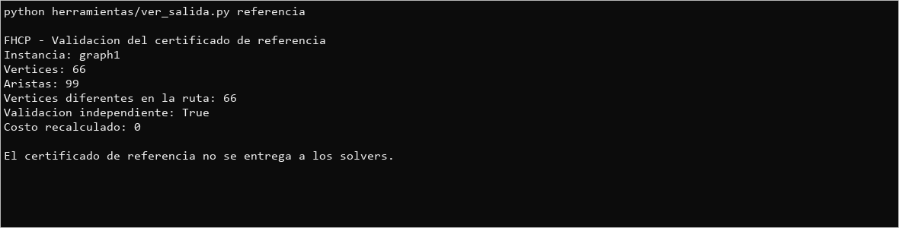
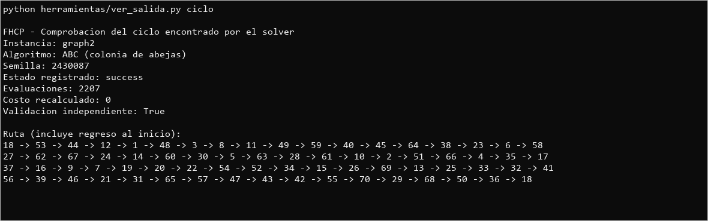
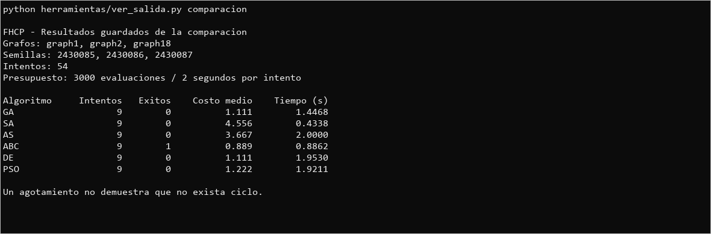
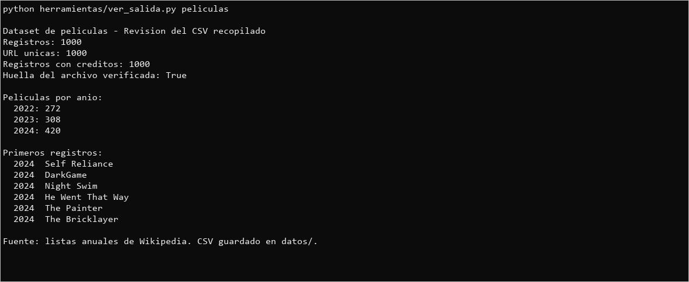
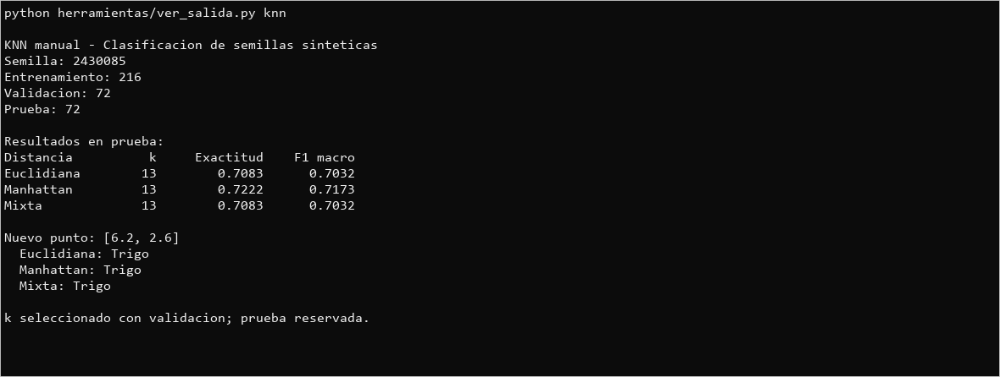
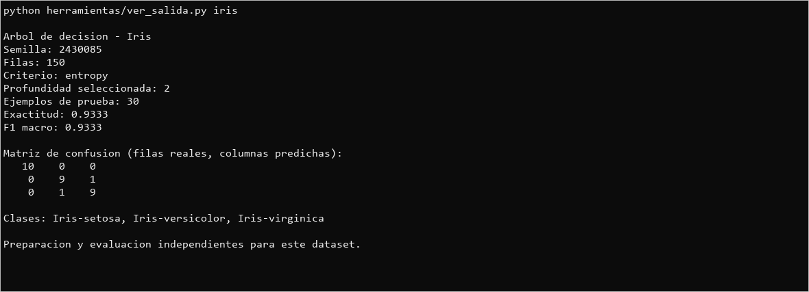
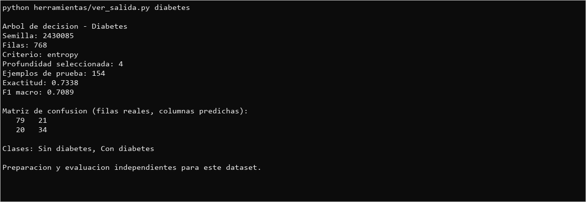

# Fundamentos de Inteligencia Artificial · Unidad 3

**Elias de Jesus Zuñiga de Leon** · **Matrícula: 2430085**

Actividades realizadas en la unidad 3 de Fundamentos de Inteligencia Artificial.

[Ver las interfaces de las aplicaciones](capturas/gui/)

## 1. FHCP Challenge: ciclos hamiltonianos

Búsqueda de rutas cerradas que visitan todos los vértices una sola vez. Incluye algoritmos genéticos, recocido simulado, colonia de hormigas, colonia de abejas, evolución diferencial y enjambre de partículas.

Trabajo en equipo con **Diego Eduardo Zapata Aguilar**, **Junior Arturo Vázquez Leonel**, **César Euresti** y **Eder Omar Zúñiga Zavala**.

[Código y actividad](01-fhcp-challenge/) · [Cuaderno de análisis](01-fhcp-challenge/analisis_fhcp.ipynb) · [Informe de resultados](01-fhcp-challenge/informe.md)

### 1.1. Validación del certificado de referencia

Se comprobó el ciclo oficial de graph1, con 66 vértices y 99 aristas. El certificado se utiliza para verificar la referencia y se mantiene separado de las búsquedas.

### 1.2. Ciclo encontrado por el solver

La colonia de abejas encontró un ciclo de costo cero en graph2. La ruta se comprobó con un validador independiente.

### 1.3. Comparación de metaheurísticas

Se realizaron 54 intentos: seis algoritmos, tres grafos y tres semillas, con un máximo de 3,000 evaluaciones y dos segundos por intento. Se obtuvo un ciclo certificado; los otros intentos conservaron sus mejores rutas al agotar el presupuesto.

## 2. Dataset de películas

Crawler de Wikipedia que genera un CSV con títulos, años, compañías, créditos y enlaces de procedencia. La aplicación permite buscar películas, filtrar por año y exportar una selección.

Se recopilaron **1,000 películas con URL únicas** de las listas de 2022, 2023 y 2024.

[Código y actividad](02-dataset-peliculas/) · [Dataset CSV](02-dataset-peliculas/datos/peliculas.csv) · [Cuaderno de análisis](02-dataset-peliculas/analisis_dataset.ipynb)

## 3. K vecinos más cercanos desde cero

Implementación manual de KNN con distancias euclidiana, Manhattan y mixta. Se comparan las regiones de decisión, las matrices de confusión y la clasificación de un punto nuevo.

El experimento usa 360 observaciones sintéticas de semillas y selecciona k con validación. En prueba, Manhattan obtuvo 72.2% de exactitud; euclidiana y mixta obtuvieron 70.8%.

[Código y actividad](03-knn-desde-cero/) · [Cuaderno ejecutado](03-knn-desde-cero/knn_manual.ipynb) · [Resultados](03-knn-desde-cero/resultados/experimento.json)

## 4. Aprendizaje automático: árboles de decisión

Análisis exploratorio, preparación de datos y clasificación con árboles de decisión. Se elige la profundidad mediante validación y se evalúa con datos de prueba reservados.

[Código y actividad](04-aprendizaje-automatico/) · [Cuaderno ejecutado](04-aprendizaje-automatico/arboles_decision.ipynb)

### 4.1. Iris

Se clasificaron las tres especies de Iris con sus cuatro medidas. El árbol de profundidad 2 obtuvo 93.3% de exactitud en los 30 ejemplos de prueba.

### 4.2. Diabetes

Se prepararon los valores faltantes mediante imputación por mediana y se entrenó un árbol de profundidad 4. La evaluación obtuvo 73.4% de exactitud en los 154 ejemplos de prueba.

