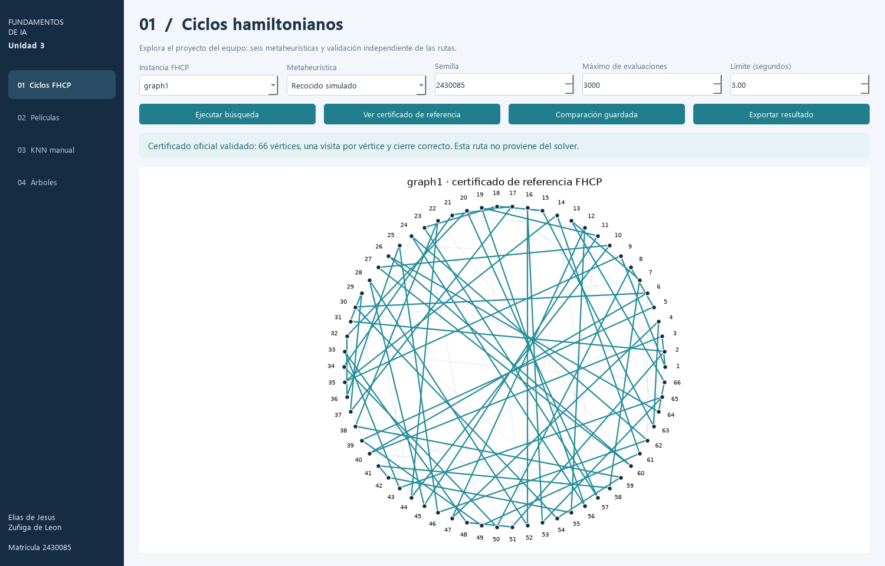
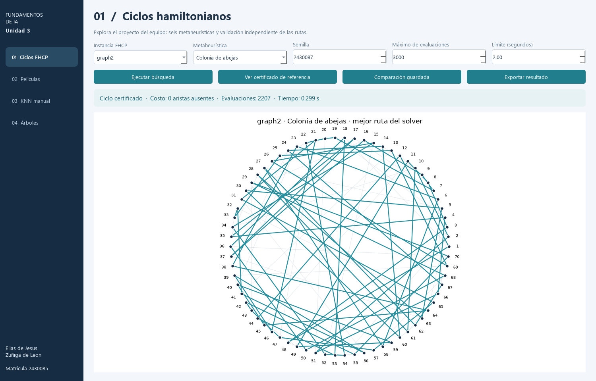
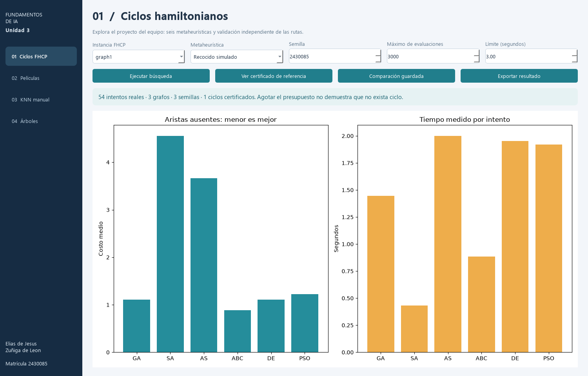
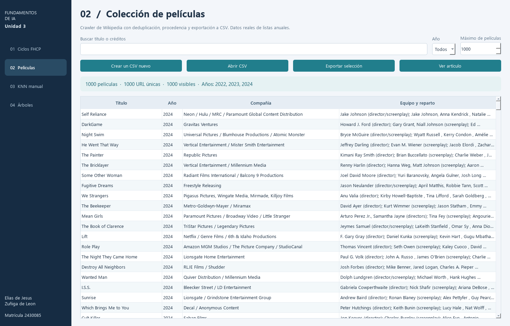
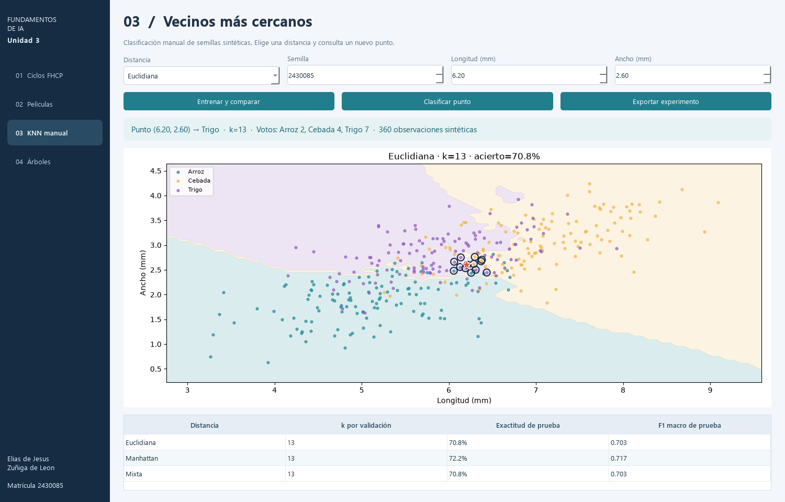
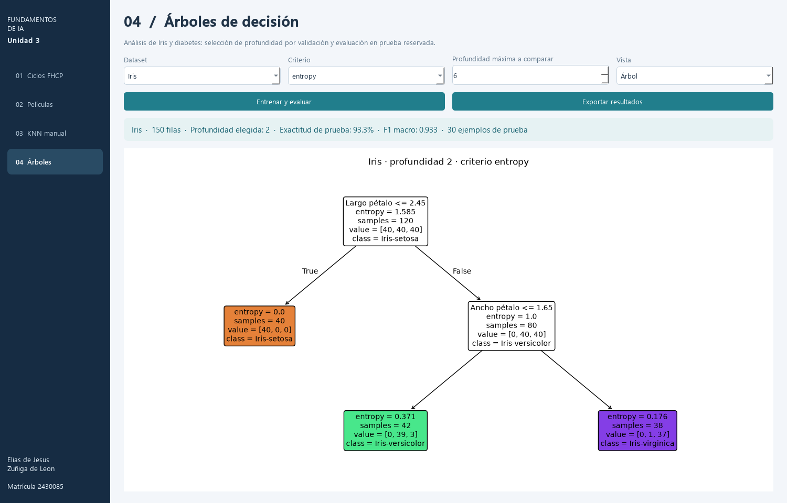
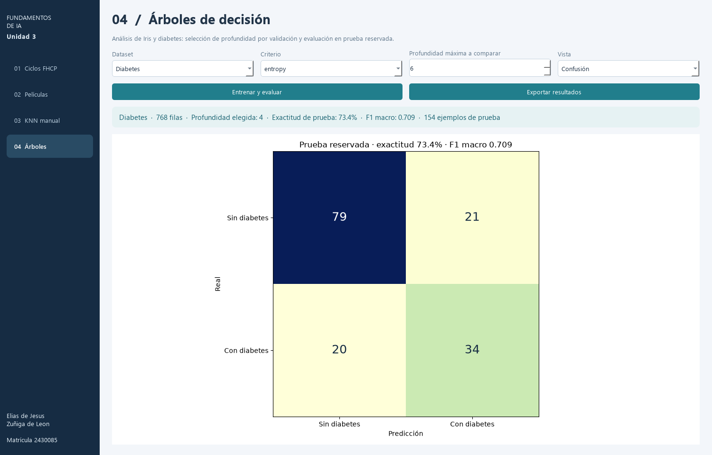

# Interfaces de las aplicaciones

Estas capturas muestran las ventanas de las aplicaciones. Las evidencias principales del README usan las salidas sencillas de cada actividad.

## FHCP: interfaz adicional

La interfaz y la comparación se añadieron aparte del código original del equipo, que se conserva intacto.

## Dataset de películas

## KNN

## Árboles de decisión

